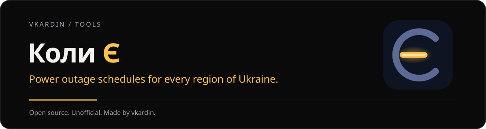

<p align="center"></p>

<h1 align="center">Коли Є</h1>

<p align="center"><b>Planned power outage schedules for every region of Ukraine, right on your desktop</b><br>
English · <a href="README.uk.md">Українська</a> · <a href="README.ru.md">Русский</a></p>

<p align="center">
<a href="https://github.com/vkardin/koly/releases"></a>
<a href="https://github.com/vkardin/koly/actions/workflows/data.yml"></a>
<a href="https://github.com/vkardin/koly/actions/workflows/data-tests.yml"></a>

<a href="LICENSE"></a>
</p>

**Koly Ye** (Ukrainian for *"when is there [power]"*) shows when the lights go off and come back for your region and outage group. Pick a region, pick your group, and see the status right now, a countdown to the next change and a 24-hour strip for today and tomorrow. Free, no account, no tracking, works offline.

> [!IMPORTANT]
> Koly Ye is an **unofficial** app. It is not affiliated with DTEK, YASNO, any oblenergo or government body. Schedules come from public sources and may be late or differ from the official ones. The official information is always on your supplier's website.

## Download

- **Windows widget:** [koly-widget-1.0.0-setup.exe](https://github.com/vkardin/koly/releases/download/desktop-v1.0.0/koly-widget-1.0.0-setup.exe), Windows 10 and 11. Installs for the current user, no admin rights needed.
- **Android app:** [koly-1.0.0.apk](https://github.com/vkardin/koly/releases/download/android-v1.0.0/koly-1.0.0.apk), Android 8.0 and newer. The first time, Android asks you to allow installs from your browser or file manager.

Older versions are in [Releases](https://github.com/vkardin/koly/releases).

The installer is not code-signed yet. If SmartScreen warns you, click **More info → Run anyway**.

## Features

- **Region and group, not addresses.** Choose your region and outage group (`1.1`, `3.2`…) once.
- **Up to 10 places:** home, work, parents, each with its own region and group.
- **Status at a glance:** power on, off or maybe off, shown by colour *and* text, with a large countdown to the next change.
- **Today and tomorrow:** a 24-hour strip labelled with the real switch times, not an even scale.
- **Three widget views:** Strip, Card and Ring. Stay on top of all windows or sit on the desktop under them.
- **Notifications** before an outage and before power returns, when the schedule changes and when tomorrow's schedule is published. Quiet hours at night.
- **Offline:** the last schedule is cached and marked with how old it is.
- **Light and tiny:** Tauri 2 and plain TypeScript, an installer of a couple of megabytes.
- Українська, English, Русский.

## Regions

Every distribution operator publishes schedules in its own way, so regions are added one parser at a time. Live status of each source: [data/SOURCES.md](data/SOURCES.md). Is your region missing or wrong? [Open an issue](https://github.com/vkardin/koly/issues/new/choose).

## How it works

```
oblenergo sites and APIs ──► data/ parsers (GitHub Actions, every 10 min)
                              │  normalize + validate (schema v1)
                              ▼
                 vkardin.github.io/koly/v1/  (static JSON on GitHub Pages)
                              │
                              ▼
                     Windows widget · Android app
```

The apps never call the suppliers' sites. They read only the published JSON:

- [`v1/index.json`](https://vkardin.github.io/koly/v1/index.json): regions, groups, status and update time
- `v1/regions/<id>.json`: outage intervals per group for today and tomorrow, in `Europe/Kyiv` time

A source that fails never overwrites valid data: the last good schedule stays and the region is marked `stale`. The schema lives in [`data/common/models.py`](data/common/models.py).

## Repository

| Folder | What is inside |
|---|---|
| [`data/`](data) | Python parsers that turn public schedules into normalized JSON, with fixtures and tests |
| `desktop/` | Windows widget (Tauri 2, TypeScript) |
| [`.github/workflows/`](.github/workflows) | `data.yml` publishes schedules every 10 minutes; `data-tests.yml` runs the parser tests |

## Contributing

Bug reports, wrong schedules and new sources are welcome. See [CONTRIBUTING.md](CONTRIBUTING.md); adding a region is described in [data/SOURCES.md](data/SOURCES.md#adding-a-provider).

## Privacy

Koly Ye has no accounts, no analytics and no ads. It only downloads the public schedule files listed above.

## Support

Koly Ye is free. If it helps you, you can support development on [Ko-fi](https://ko-fi.com/vkardin) or [Donatello](https://donatello.to/vkardin). A ⭐ helps other people find it.

## License

[MIT](LICENSE) © vkardin

<!-- project-family:start -->

[**vkardin / tools — all projects ↗**](https://vkardin.github.io/)
## More tools by vkardin

| Project | Projects |
| --- | --- |
| **[Snapt](https://vkardin.github.io/snapt/)** | Capture, annotate and export. A Windows, macOS and Linux app, plus a browser extension. [GitHub](https://github.com/vkardin/snapt) |
| **[Video Glow](https://vkardin.github.io/video-glow/)** | Ambient light around web videos. Soft glow, LED strips and room colour. [GitHub](https://github.com/vkardin/video-glow) |
| **[Leveler](https://vkardin.github.io/leveler/)** | Even loudness, clearer dialogue, an equalizer and playback speed controls. [GitHub](https://github.com/vkardin/leveler) |
| **[Video Drift](https://vkardin.github.io/video-drift/)** | Floating video with subtitles, saved playback positions and timestamped notes. [GitHub](https://github.com/vkardin/video-drift) |
| **[UNI](https://vkardin.github.io/uni-homebot/)** | Your home server in Telegram: apps, monitoring, notifications and a Mini App. [GitHub](https://github.com/vkardin/uni-homebot) |
| **[Tukk](https://vkardin.github.io/tukk/)** | Phone gestures for everyday actions: shake for the flashlight, flip for silence. Android, in development. [GitHub](https://github.com/vkardin/tukk) |

[github.com/vkardin](https://github.com/vkardin) · Independent tools · open source
<!-- project-family:end -->
