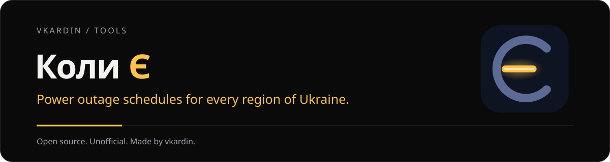

<p align="center"></p>

<h1 align="center">Коли Є</h1>

<p align="center"><b>Графики плановых отключений света для всех областей Украины прямо на рабочем столе</b><br>
<a href="README.md">English</a> · <a href="README.uk.md">Українська</a> · Русский</p>

<p align="center">
<a href="https://github.com/vkardin/koly/releases"></a>
<a href="https://github.com/vkardin/koly/actions/workflows/data.yml"></a>
<a href="https://github.com/vkardin/koly/actions/workflows/data-tests.yml"></a>

<a href="LICENSE"></a>
</p>

**Коли Є** (укр. «когда есть [свет]») показывает, когда пропадёт и когда вернётся свет для вашей области и очереди. Выберите область, выберите очередь и видите статус прямо сейчас, обратный отсчёт до следующей смены и полосу суток на сегодня и завтра. Бесплатно, без аккаунта, без слежки, работает офлайн.

> [!IMPORTANT]
> Коли Є — **неофициальное** приложение. Оно не связано с ДТЭК, YASNO, облэнерго и государственными органами. Графики берутся из открытых источников и могут запаздывать или отличаться от официальных. Официальная информация всегда на сайте вашего поставщика.

## Скачать

- **Виджет для Windows:** `koly-widget-<версия>-setup.exe` в [Releases](https://github.com/vkardin/koly/releases). Устанавливается для текущего пользователя, без прав администратора.
- **Android:** в разработке, после версии 1.0.

Установщик пока не подписан. Если SmartScreen предупреждает, нажмите **Подробнее → Выполнить в любом случае**.

## Возможности

- **Область и очередь, без адресов.** Выберите область и очередь (`1.1`, `3.2`…) один раз.
- **До 10 мест:** дом, работа, родители, у каждого своя область и очередь.
- **Статус сразу виден:** свет есть, нет или возможно отключение, цветом *и* текстом, с крупным отсчётом до следующей смены.
- **Сегодня и завтра:** полоса суток с подписями реальных моментов смены, а не равномерной шкалой.
- **Три вида виджета:** Смужка, Картка и Кільце. Поверх всех окон или на рабочем столе под ними.
- **Уведомления** перед отключением и перед возвращением света, когда график изменился и когда опубликован график на завтра. Тишина ночью.
- **Офлайн:** последний график сохраняется с пометкой, насколько он свежий.
- **Лёгкий:** Tauri 2 и обычный TypeScript, установщик на пару мегабайт.
- Українська, English, Русский.

## Области

Каждое облэнерго публикует графики по-своему, поэтому области добавляются по одной. Состояние каждого источника: [data/SOURCES.md](data/SOURCES.md). Вашей области нет или график неверный? [Создайте issue](https://github.com/vkardin/koly/issues/new/choose).

## Как это работает

```
сайты и API облэнерго ──► парсеры data/ (GitHub Actions, каждые 10 мин)
                              │  нормализация + проверка (схема v1)
                              ▼
                 vkardin.github.io/koly/v1/  (статические JSON на GitHub Pages)
                              │
                              ▼
                  виджет для Windows · приложение Android
```

Приложения никогда не обращаются к сайтам поставщиков, они читают только опубликованные JSON:

- [`v1/index.json`](https://vkardin.github.io/koly/v1/index.json): области, очереди, статус и время обновления
- `v1/regions/<id>.json`: интервалы отключений для каждой очереди на сегодня и завтра, по времени `Europe/Kyiv`

Сбой источника никогда не затирает правильные данные: остаётся последний рабочий график, а область помечается как `stale`. Схема описана в [`data/common/models.py`](data/common/models.py).

## Репозиторий

| Папка | Что внутри |
|---|---|
| [`data/`](data) | Парсеры на Python, превращающие открытые графики в единый JSON, с фикстурами и тестами |
| `desktop/` | Виджет для Windows (Tauri 2, TypeScript) |
| [`.github/workflows/`](.github/workflows) | `data.yml` публикует графики каждые 10 минут; `data-tests.yml` запускает тесты парсеров |

## Участие

Сообщения об ошибках, неверных графиках и новые источники приветствуются. См. [CONTRIBUTING.md](CONTRIBUTING.md); как добавить область, описано в [data/SOURCES.md](data/SOURCES.md#adding-a-provider).

## Приватность

В Коли Є нет аккаунтов, аналитики и рекламы. Приложение загружает только открытые файлы графиков, перечисленные выше.

## Поддержка

Коли Є бесплатный. Если он вам помогает, поддержите разработку на [Ko-fi](https://ko-fi.com/vkardin) или [Donatello](https://donatello.to/vkardin). ⭐ на GitHub помогает другим его найти.

## Лицензия

[MIT](LICENSE) © vkardin
