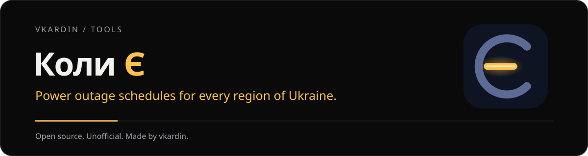

<p align="center"></p>

<h1 align="center">Коли Є</h1>

<p align="center"><b>Графіки планових відключень світла для всіх областей України просто на робочому столі</b><br>
<a href="README.md">English</a> · Українська · <a href="README.ru.md">Русский</a></p>

<p align="center">
<a href="https://github.com/vkardin/koly/releases"></a>
<a href="https://github.com/vkardin/koly/actions/workflows/data.yml"></a>
<a href="https://github.com/vkardin/koly/actions/workflows/data-tests.yml"></a>

<a href="LICENSE"></a>
</p>

**Коли Є** показує, коли зникне і коли повернеться світло для вашої області та черги. Оберіть область, оберіть чергу і бачите статус просто зараз, зворотний відлік до наступної зміни та смугу доби на сьогодні й завтра. Безкоштовно, без акаунта, без стеження, працює офлайн.

> [!IMPORTANT]
> Коли Є — **неофіційний** застосунок. Він не пов'язаний із ДТЕК, YASNO, обленерго чи державними органами. Графіки беруться з відкритих джерел і можуть запізнюватися або відрізнятися від офіційних. Офіційна інформація завжди на сайті вашого постачальника.

## Завантажити

- **Віджет для Windows:** [koly-widget-1.0.0-setup.exe](https://github.com/vkardin/koly/releases/download/desktop-v1.0.0/koly-widget-1.0.0-setup.exe), Windows 10 і 11. Встановлюється для поточного користувача, без прав адміністратора.
- **Застосунок для Android:** [koly-1.0.0.apk](https://github.com/vkardin/koly/releases/download/android-v1.0.0/koly-1.0.0.apk), Android 8.0 і новіші. Під час першого встановлення Android попросить дозволити встановлення з браузера чи файлового менеджера.

Попередні версії лежать у [Releases](https://github.com/vkardin/koly/releases).

Інсталятор поки не підписаний. Якщо SmartScreen попереджає, натисніть **Докладніше → Усе одно запустити**.

## Можливості

- **Область і черга, без адрес.** Оберіть область і чергу (`1.1`, `3.2`…) один раз.
- **До 10 місць:** дім, робота, батьки, кожне зі своєю областю і чергою.
- **Статус одразу видно:** світло є, немає чи можливе відключення, кольором *і* текстом, з великим відліком до наступної зміни.
- **Сьогодні й завтра:** смуга доби з підписами реальних моментів зміни, а не рівномірною шкалою.
- **Три вигляди віджета:** Смужка, Картка і Кільце. Поверх усіх вікон або на робочому столі під ними.
- **Сповіщення** перед відключенням і перед поверненням світла, коли графік змінився і коли опубліковано графік на завтра. Тиша вночі.
- **Офлайн:** останній графік зберігається з позначкою, наскільки він свіжий.
- **Легкий:** Tauri 2 і звичайний TypeScript, інсталятор на кілька мегабайтів.
- Українська, English, Русский.

## Області

Кожне обленерго публікує графіки по-своєму, тому області додаються по одній. Стан кожного джерела: [data/SOURCES.md](data/SOURCES.md). Вашої області немає або графік неправильний? [Створіть issue](https://github.com/vkardin/koly/issues/new/choose).

## Як це працює

```
сайти та API обленерго ──► парсери data/ (GitHub Actions, кожні 10 хв)
                              │  нормалізація + перевірка (схема v1)
                              ▼
                 vkardin.github.io/koly/v1/  (статичні JSON на GitHub Pages)
                              │
                              ▼
                  віджет для Windows · застосунок Android
```

Застосунки ніколи не звертаються до сайтів постачальників, вони читають лише опубліковані JSON:

- [`v1/index.json`](https://vkardin.github.io/koly/v1/index.json): області, черги, статус і час оновлення
- `v1/regions/<id>.json`: інтервали відключень для кожної черги на сьогодні й завтра, за часом `Europe/Kyiv`

Збій джерела ніколи не затирає правильні дані: залишається останній робочий графік, а область позначається як `stale`. Схема описана в [`data/common/models.py`](data/common/models.py).

## Репозиторій

| Тека | Що всередині |
|---|---|
| [`data/`](data) | Парсери на Python, що перетворюють відкриті графіки на єдиний JSON, з фікстурами та тестами |
| `desktop/` | Віджет для Windows (Tauri 2, TypeScript) |
| [`.github/workflows/`](.github/workflows) | `data.yml` публікує графіки кожні 10 хвилин; `data-tests.yml` запускає тести парсерів |

## Долучитися

Повідомлення про помилки, неправильні графіки та нові джерела — вітаються. Див. [CONTRIBUTING.md](CONTRIBUTING.md); як додати область, описано в [data/SOURCES.md](data/SOURCES.md#adding-a-provider).

## Приватність

У Коли Є немає акаунтів, аналітики та реклами. Застосунок завантажує лише відкриті файли графіків, наведені вище.

## Підтримка

Коли Є безкоштовний. Якщо він вам допомагає, підтримайте розробку на [Donatello](https://donatello.to/vkardin) або [Ko-fi](https://ko-fi.com/vkardin). ⭐ на GitHub допомагає іншим його знайти.

## Ліцензія

[MIT](LICENSE) © vkardin
